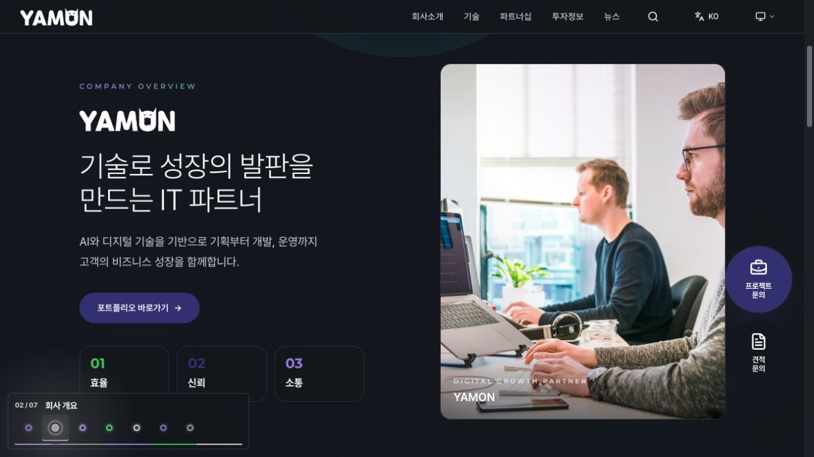
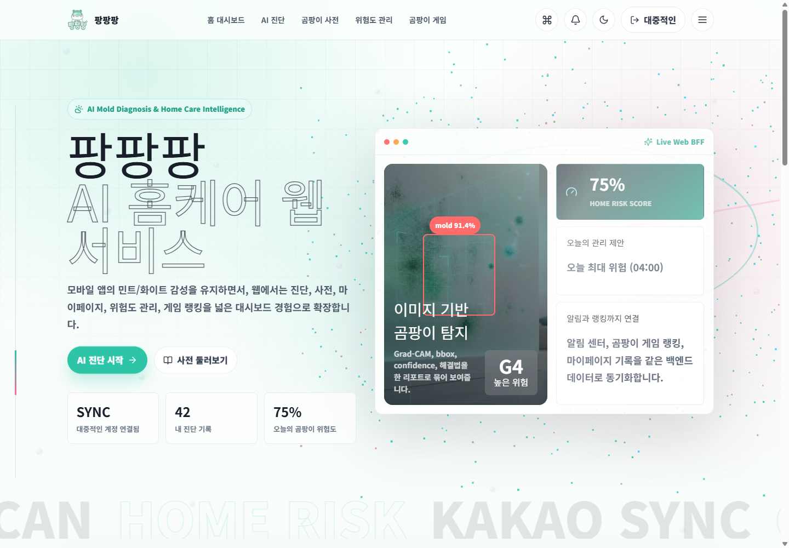
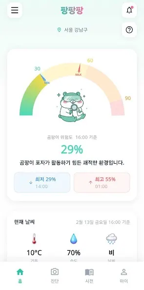
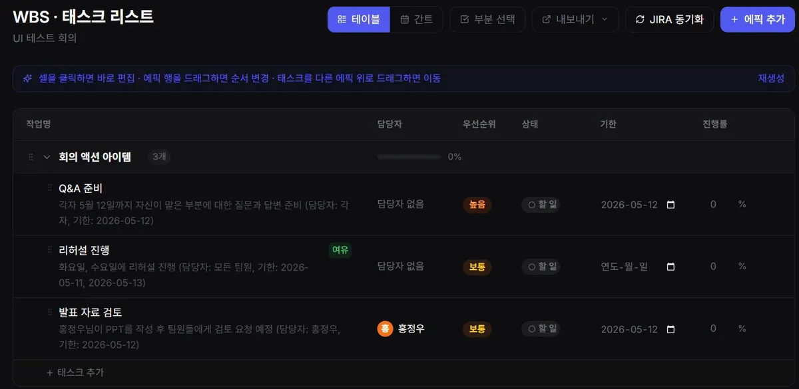

<a href="https://dejung71020.github.io/">
  <picture>
    <source media="(prefers-color-scheme: dark)" srcset="assets/profile-cover-dark.svg" />
    
  </picture>
</a>

# dejung71020

**UI 디자인 · 웹·앱 · API 개발**

[**포트폴리오 ↗**](https://dejung71020.github.io/) · [위시켓](https://www.wishket.com/partners/p/dejung71020/) · [프리모아](https://www.freemoa.net/m7/freelance_detail?fno=55264)

## 01 / YAMON 홈페이지

**담당: UI 디자인 · 화면 구현**

기업 소개·서비스 안내·포트폴리오 탐색 화면.

`Astro` `React` `TypeScript` `Tailwind CSS` `Swiper` `Nanostores` `i18next`

[**사이트 보기 ↗**](https://yamon.io/ko/home)

## 02 / 팡팡팡 · 웹 & 앱

[**웹사이트 보기 ↗**](https://pangpangpangs.com/)

<table>
  <tr>
    <td width="30%" align="center" valign="middle">
      
    </td>
    <td width="70%" valign="middle">
      <h3>웹에서도, 앱에서도.</h3>
      
사진 진단 · 곰팡이 사전 · 위험도 관리

      
<strong>Web + Mobile + AI</strong>

      
<a href="https://play.google.com/store/apps/details?id=com.quail.pangpangpang"><strong>Google Play ↗</strong></a> · <a href="assets/pangpangpang.webp">화면 원본</a>

    </td>
  </tr>
</table>

| 영역 | 프로젝트 기술 |
| :--- | :--- |
| **Web** | Next.js · React · TypeScript · Tailwind CSS · Zustand · TanStack Query |
| **Motion · 3D** | Three.js · GSAP · Framer Motion · Lenis |
| **App** | Flutter · Dart · Provider · Dio |
| **API** | Python · FastAPI · SQLAlchemy · Pydantic · APScheduler |
| **AI · Search** | ONNX Runtime · OpenCV · Gemini · ChromaDB · RAG |
| **Data · Cloud** | MySQL · AWS EC2 · S3 · Route 53 |
| **Deploy · Auth** | Docker Compose · nginx · JWT · Kakao OAuth · Firebase FCM |

## 03 / 회의 에이전트

회의 기록 → 할 일 정리 → 업무 도구 연동.

| 영역 | 프로젝트 기술 |
| :--- | :--- |
| **API** | Python · FastAPI · SQLAlchemy · Pydantic · httpx |
| **AI · Agent** | LangChain · LangGraph · OpenAI · Tavily · RAG |
| **Data** | MySQL · MongoDB · Redis · ChromaDB · AWS S3 |
| **Auth · 연동** | JWT · OAuth 2.0 · Jira · Slack · Google Calendar · Notion · Kakao |
| **Deploy · Test** | Docker Compose · nginx · pytest · pytest-asyncio |

[**백엔드 코드 ↗**](https://github.com/dejung71020/workb-backend) · [화면 원본](assets/meeting-agent-wbs.webp)

참여 범위 · 자료 출처

- **YAMON:** 2026년 7월 초~중순, 약 2주. 해당 UI 디자인·화면 구현 참여율 100%. 서비스 전체 개발 참여율을 뜻하지 않습니다.
- **팡팡팡:** 웹 이미지는 기존 저장된 로그인 상태의 실제 화면입니다. 사용자 요청에 따라 사용했으며, 현재 시점에 로그인·진단 기능을 새로 실행한 결과는 아닙니다. 앱 이미지는 기존 공개 자료입니다.
- **팡팡팡·회의 에이전트:** 화면과 코드 구성을 바탕으로 소개합니다. 개인 담당 기능·PR·기여율은 추가 확인이 필요합니다. 이번 소개가 현재 서비스 동작이나 외부 계정 연동을 새로 검증했다는 뜻은 아닙니다.
- **기술 표기 기준:** 프로젝트의 의존성·코드 import·배포 구성과 문서를 확인했습니다. Route 53은 팡팡팡 공개 README의 배포 구성 기준입니다. OpenAI는 회의 에이전트 코드에서 확인됐으며, 팡팡팡은 Gemini 사용 코드가 확인돼 구분했습니다. 프로젝트 기술 구성이 각 기술의 단독 구현이나 숙련도 등급을 뜻하지 않습니다.
- 회사·고객 내부 코드와 운영 데이터는 포함하지 않습니다.

## Stack

| 분야 | 주요 기술 |
| :--- | :--- |
| **Web · UI** | TypeScript · React · Next.js · Astro · Tailwind CSS |
| **Motion · 3D** | Three.js · GSAP · Framer Motion · Swiper · Lenis |
| **App** | Dart · Flutter · Provider · Dio |
| **Backend** | Python · FastAPI · SQLAlchemy · PHP · CodeIgniter |
| **AI · Agent** | OpenAI · Gemini · LangChain · LangGraph · ONNX Runtime · OpenCV · RAG |
| **Data** | MySQL · MongoDB · Redis · ChromaDB |
| **Cloud · Delivery** | AWS EC2 · S3 · Route 53 · Docker Compose · nginx |
| **Auth · Notification** | JWT · OAuth 2.0 · Kakao · Firebase FCM |
| **Quality** | pytest · pytest-asyncio · Vitest · Playwright |

---

**웹사이트·앱, 필요한 화면이나 기능을 보내주세요.**

[**위시켓에서 상담 ↗**](https://www.wishket.com/partners/p/dejung71020/) · [프리모아](https://www.freemoa.net/m7/freelance_detail?fno=55264)
